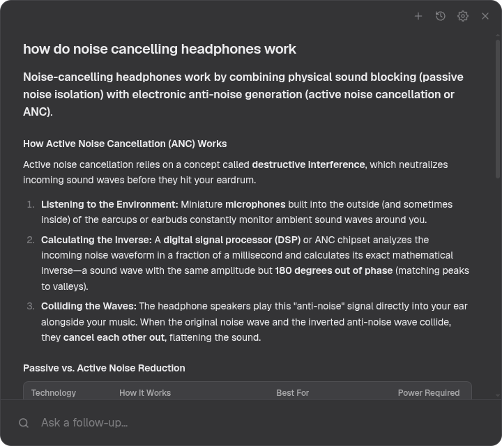
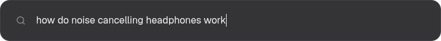
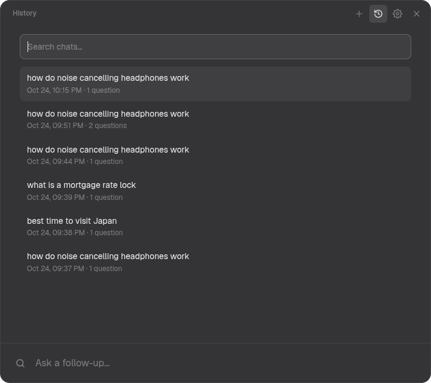
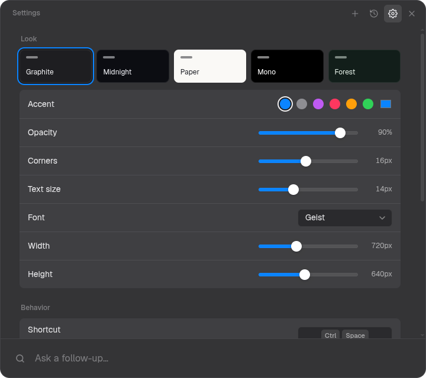
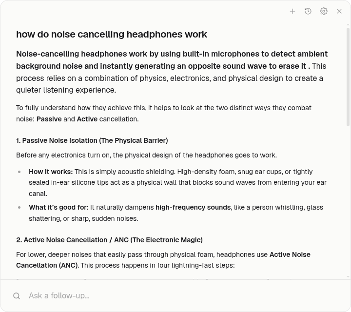

<p align="center"></p>

<h1 align="center">Glimpse</h1>

<p align="center">Ответы ИИ от Google в быстром всплывающем окне, с уточняющими вопросами.<br/>Linux · Windows · macOS</p>

<p align="center"><a href="../../releases/latest"><b>Скачать</b></a> · <a href="README.md">English</a></p>

<p align="center"></p>

Нажимаете сочетание клавиш, пишете вопрос и читаете ответ ИИ от Google прямо в окне,
а потом спрашиваете дальше. Без API-ключей и без аккаунта: Glimpse открывает режим ИИ
Google в скрытом окне браузера и показывает ответ в своём чистом интерфейсе.

Glimpse по-английски значит «мимолётный взгляд»: открыл, глянул на ответ, закрыл.

## Как выглядит

Поверх любого окна открывается небольшая строка. Напишите вопрос и нажмите `Enter`:

<p align="center"></p>

Когда приходит ответ, строка раскрывается в чат. Уточняющие вопросы идут в том же разговоре.

<table>
  <tr>
    <td></td>
    <td></td>
    <td></td>
  </tr>
  <tr>
    <td align="center">История с поиском</td>
    <td align="center">Темы и настройки</td>
    <td align="center">Светлая тема</td>
  </tr>
</table>

Интерфейс есть на русском: Настройки → Interface language → Русский.

## Возможности

- Строка в стиле Spotlight, которая раскрывается в чат; каждое открытие начинает новый чат
- Уточняющие вопросы в том же разговоре
- Вопрос по картинке: вставьте её через `Ctrl+V` или перетащите в окно
- Ответ сохраняет структуру: заголовки, списки, таблицы, жирный текст, источники
- Пять тем (Стекло, Полночь, Бумага, Моно, Лес), цвет акцента, прозрачность, скругление, шрифт, размер
- История чатов с поиском
- Глобальное сочетание клавиш, значок в трее, запуск при входе в систему
- Обновляется сам на Windows и Linux (AppImage); на macOS сообщает о новой версии
- Интерфейс на русском и английском

## Установка

Скачайте файл для своей системы в [Releases](../../releases/latest):

| Система | Файл |
| --- | --- |
| Windows | `Glimpse-Setup-x.y.z.exe` |
| macOS, Apple silicon (M1 и новее) | `Glimpse-x.y.z-arm64.dmg` |
| macOS, Intel | `Glimpse-x.y.z.dmg` |
| Linux, любой дистрибутив | `Glimpse-x.y.z.AppImage`: `chmod +x`, затем запустить |

- **macOS:** приложение не нотаризовано. В первый раз нажмите на него правой кнопкой и выберите «Открыть».
  Если macOS пишет, что приложение «повреждено», один раз выполните `xattr -cr /Applications/Glimpse.app`.
- **Windows:** SmartScreen может написать «Неизвестный издатель». Нажмите «Подробнее» → «Выполнить в любом случае».

## Управление

| Действие | Клавиши |
| --- | --- |
| Открыть или скрыть | `Ctrl+Space` (`⌥Space` на macOS), меняется в Настройках |
| Спросить | `Enter` |
| Открыть чат в браузере | `Ctrl+Enter` / `⌘↵` |
| Новый чат | `Ctrl+N` / `⌘N` |
| История | `Ctrl+H` / `⌘H` |
| Настройки | `Ctrl+,` / `⌘,` |
| Назад / скрыть | `Esc` |

Если Google попросит подтвердить, что вы не робот, Glimpse покажет страницу Google:
пройдите проверку один раз, и ответ продолжит загружаться.

### Для Linux

- На Wayland глобальное сочетание клавиш работает через портал рабочего стола. Если ваше
  окружение его не поддерживает, назначьте в оконном менеджере любую клавишу на команду
  `glimpse` (повторный запуск открывает и прячет окно).
- В Hyprland окно можно сделать без рамки, с размытием фона и удержанием фокуса (иначе при
  `follow_mouse` окно прячется, стоит увести мышь). «Скругление» в Настройках держите не
  больше 20 px, это максимум Hyprland, иначе размытие вылезет за углы:

  ```lua
  o.window({ class = "^glimpse$", title = "^Glimpse$" }, { float = true, no_shadow = true, border_size = 0, rounding = 20, stay_focused = true })
  ```

## Сборка из исходников

```bash
npm install
npm start          # собрать и запустить
npm test           # сквозные тесты на настоящем приложении
npm run dist       # собрать установщик для текущей системы в dist/
```

Написано на TypeScript, компилируется `tsc` в `out/`, без сборщика.
Релизы собирает GitHub Actions под все три системы, когда пушится тег `v*`.

## Как это работает

`src/main/google.ts` держит скрытое окно Chromium на странице режима ИИ Google.
`src/page/extract.ts` выполняется внутри этой страницы и превращает ответ в простые блоки
(абзацы, заголовки, пункты списков, таблицы). Интерфейс в `src/ui/` рисует эти блоки;
разметка Google никогда не вставляется как HTML.

Если Google поменяет страницу и ответы перестанут появляться, править нужно `src/page/extract.ts`.

## Отказ от ответственности

Glimpse не связан с Google. Он показывает те же ответы, что и google.com, в вашей
собственной сессии браузера.

## Лицензия

MIT
